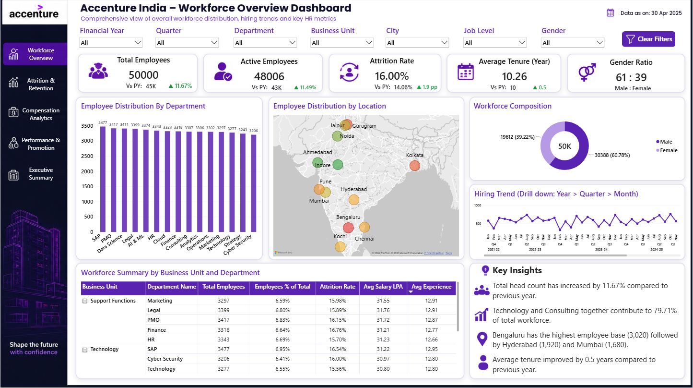
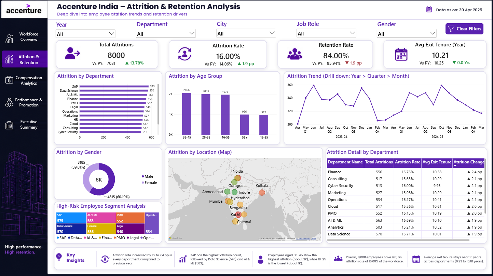
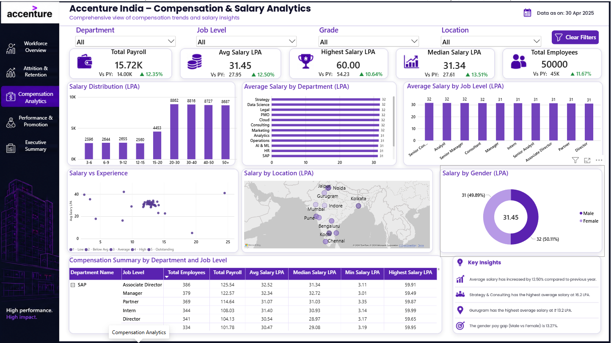
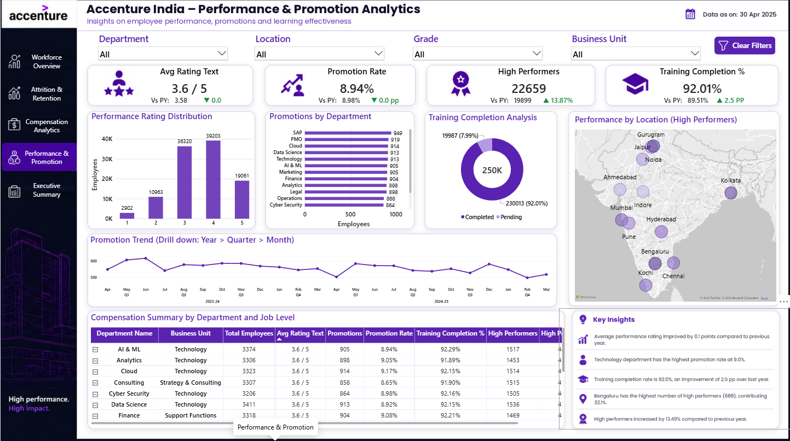
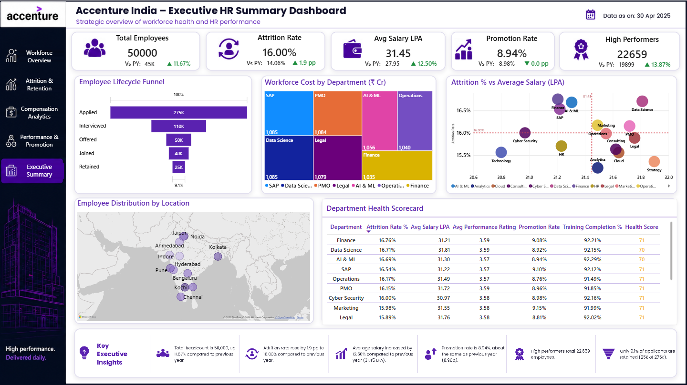

<div align="center">

# 👥 Accenture India HR Analytics Dashboard
### *Interactive Power BI Report — Workforce, Attrition, Compensation, Performance & Executive Summary*

[](https://powerbi.microsoft.com/)
[](https://powerbi.microsoft.com/)
[](https://www.microsoft.com/en-us/microsoft-365/excel)
[](https://powerbi.microsoft.com/)

<br/>

> *"People data tells the story of an organisation — visualise it well, and it becomes a strategy for growth and retention."*

</div>

---

## 📋 Table of Contents

- [📌 Overview](#-overview)
- [🎯 Problem Statement](#-problem-statement)
- [✨ Key Features](#-key-features)
- [🏗️ Project Structure](#️-project-structure)
- [🔄 Project Workflow](#-project-workflow)
- [🔺 Page 1 — Workforce Overview](#-page-1--workforce-overview)
- [🔺 Page 2 — Attrition & Retention](#-page-2--attrition--retention)
- [🔺 Page 3 — Compensation Analytics](#-page-3--compensation-analytics)
- [🔺 Page 4 — Performance & Promotion](#-page-4--performance--promotion)
- [🔺 Page 5 — Executive Summary](#-page-5--executive-summary)
- [🛠️ Tech Stack](#️-tech-stack)
- [📈 Results & Insights](#-results--insights)
- [🏆 Advantages](#-advantages)
- [📄 License](#-license)
- [👤 Author](#-author)
- [🙏 Acknowledgements](#-acknowledgements)

---

## 📌 Overview

The **Accenture India HR Analytics Dashboard** is a five-page interactive Power BI report that gives HR leadership a consolidated view of **workforce distribution**, **attrition and retention**, **compensation**, **performance and promotions**, and an **executive health summary**. Every page carries its own dropdown slicers, a **Clear Filters** button, and KPI cards that show current-year values alongside previous-year comparisons.

All pages carry the data-as-on stamp **30 Apr 2025** and share a consistent purple-and-dark Accenture-inspired theme with a left-hand navigation panel.

This project is designed to:
- Track total headcount, active employees, tenure and gender mix across departments, business units and cities
- Understand who is leaving, from where, and at what age or tenure, using attrition and retention metrics
- Analyse payroll, salary distribution and the gender pay gap across departments, job levels and locations
- Measure performance ratings, promotion rates, high performers and training completion
- Provide an executive scorecard that combines hiring funnel, workforce cost and department health

---

## 🎯 Problem Statement

> **Objective:** Build an interactive Power BI dashboard that helps HR and business leaders monitor workforce health, understand attrition drivers, evaluate compensation fairness and track performance and promotion outcomes across Accenture India.

A large services organisation with 50,000 employees across 15 departments and multiple Indian cities needs to answer questions such as: *How is headcount growing? Which departments and age groups see the most attrition? Is pay equitable? Are high performers being recognised and developed? Which departments are healthiest?*

| 📂 Page | 📄 Focus | 🔍 Core Question Answered |
|--------|---------|---------------------------|
| Workforce Overview | Headcount & demographics | How big is the workforce, and how is it distributed? |
| Attrition & Retention | Employee exits | Who is leaving, where and why does it matter? |
| Compensation Analytics | Pay & payroll | How are salaries distributed, and is pay equitable? |
| Performance & Promotion | Talent outcomes | How are people rated, promoted and trained? |
| Executive Summary | Strategic overview | How healthy is each department overall? |

---

## ✨ Key Features

| Feature | Description |
|--------|-------------|
| 🎛️ **Page-specific Slicers** | Financial Year, Quarter, Year, Department, Business Unit, City / Location, Job Level / Job Role, Grade and Gender |
| 🧹 **Clear Filters Button** | One-click reset of all slicers on every page |
| 🏷️ **Dynamic KPI Cards** | Current value, previous-year value and change (green ▲ / red ▼ indicators) |
| 📉 **Trend Analysis** | Drillable Year › Quarter › Month line charts for hiring, attrition and promotions |
| 🍩 **Composition Charts** | Donut charts for workforce composition, attrition by gender, salary by gender and training completion; treemaps for high-risk segments and workforce cost |
| 🗺️ **Geographic Maps** | Bubble maps covering Bengaluru, Hyderabad, Mumbai, Pune, Chennai, Kochi, Kolkata, Gurugram, Noida, Jaipur, Ahmedabad and Indore |
| 🧮 **Hierarchical Tables** | Expandable Business Unit › Department and Department › Job Level matrices with conditional metrics |
| 🔻 **Lifecycle Funnel** | Applied → Interviewed → Offered → Joined → Retained conversion view |
| 🩺 **Department Health Scorecard** | Combines attrition, salary, rating, promotion and training into a single health score |
| 💡 **Key Insights Panels** | Text summaries of the most important findings on every page |
| 🧭 **Left Navigation** | Quick page switching across all five report pages |

---

## 🏗️ Project Structure

```
📦 Accenture-India-HR-PowerBI-Dashboard/
│
├── 📊 Accenture_India_HR_Dashboard.pbix   ← Power BI report file (5 pages)
├── 🗂️ Data/                               ← Source data files (employees, attrition, compensation, performance, hiring)
│
├── 📁 Assets/                             ← Screenshot assets for documentation
│   ├── 🖼️ Workforce_Overview.png          ← Page 1 screenshot
│   ├── 🖼️ Attrition_Retention.png         ← Page 2 screenshot
│   ├── 🖼️ Compensation_Analytics.png      ← Page 3 screenshot
│   ├── 🖼️ Performance_Promotion.png       ← Page 4 screenshot
│   └── 🖼️ Executive_Summary.png           ← Page 5 screenshot
│
└── 📄 README.md                           ← Project documentation
```

> **How to open:**
> ```
> 1. Install Power BI Desktop (free): https://powerbi.microsoft.com/desktop
> 2. Open Accenture_India_HR_Dashboard.pbix in Power BI Desktop
> 3. If prompted, re-point the data source to the files in the Data/ folder
> 4. Use the slicers on each page and the left navigation to explore
> ```

---

## 🔄 Project Workflow

```
Source Data  (Employees · Attrition · Compensation · Performance · Hiring)
       │
       ▼  Import & clean in Power BI (Power Query)
  Data Model  (Date / Department / Business Unit / City / Job Level / Grade / Gender dimensions)
       │
       ├──▶  DAX Measures Created
       │     Total Employees · Active Employees · Attrition Rate · Retention Rate · Avg Tenure
       │     Total Payroll · Avg / Median / Highest Salary · Gender Pay Gap
       │     Promotion Rate · High Performers · Training Completion % · Health Score
       │
       ├──▶  Page 1: Workforce Overview
       │     ├── 7 slicers + Clear Filters
       │     ├── 5 KPI cards (Total / Active / Attrition / Tenure / Gender Ratio)
       │     ├── Department bar · Location map · Composition donut · Hiring trend
       │     └── BU › Department summary table + Key Insights
       │
       ├──▶  Page 2: Attrition & Retention
       │     ├── 5 slicers + Clear Filters
       │     ├── 4 KPI cards (Total Attritions / Attrition Rate / Retention Rate / Avg Exit Tenure)
       │     ├── Dept bar · Age group · Trend · Gender donut · High-risk treemap · Map
       │     └── Attrition detail table + Key Insights
       │
       ├──▶  Page 3: Compensation Analytics
       │     ├── 4 slicers + Clear Filters
       │     ├── 5 KPI cards (Payroll / Avg / Highest / Median Salary / Employees)
       │     ├── Salary distribution · Dept & job level bars · Scatter · Map · Gender donut
       │     └── Compensation summary table + Key Insights
       │
       ├──▶  Page 4: Performance & Promotion
       │     ├── 4 slicers + Clear Filters
       │     ├── 4 KPI cards (Avg Rating / Promotion Rate / High Performers / Training %)
       │     ├── Rating distribution · Promotions by dept · Training donut · Map · Trend
       │     └── Summary table + Key Insights
       │
       └──▶  Page 5: Executive Summary
             ├── 5 KPI cards (Employees / Attrition / Avg Salary / Promotion / High Performers)
             ├── Lifecycle funnel · Workforce cost treemap · Attrition vs Salary scatter
             └── Location map · Department Health Scorecard + Key Executive Insights
```

---

## 🔺 Page 1 — Workforce Overview

### 📝 1. Page Architecture

This page gives a comprehensive view of the overall workforce distribution, hiring trends and key HR metrics. Seven dropdown slicers (**Financial Year, Quarter, Department, Business Unit, City, Job Level, Gender**) sit at the top, followed by five KPI cards, four visuals and a business-unit summary table.



---

### 🗺️ 2. KPI Cards

| KPI Card | Value | Previous Year | Change |
|----------|-------|---------------|--------|
| 👥 **Total Employees** | **50,000** | 45K | ▲ 11.67% |
| ✅ **Active Employees** | **48,006** | 43K | ▲ 11.49% |
| 🔄 **Attrition Rate** | **16.00%** | 14.06% | ▲ 1.9 pp |
| 📅 **Average Tenure (Year)** | **10.26** | 10 | ▲ 0.5 |
| ⚧ **Gender Ratio** | **61 : 39** (Male : Female) | — | — |

---

### 📊 3. Visuals

| Visual | Description |
|--------|-------------|
| **Employee Distribution By Department** | Column chart of 15 departments, from SAP (3,477) down to Cyber Security (3,206) |
| **Employee Distribution by Location** | Bubble map of employees across major Indian cities |
| **Workforce Composition** | Donut chart (50K centre) — Male 30,388 (60.78%), Female 19,612 (39.22%) |
| **Hiring Trend** | Drillable line chart (Year › Quarter › Month) from 2021-22 to 2024-25, ranging roughly between 800 and 1,000 hires |
| **Workforce Summary by Business Unit and Department** | Expandable table with Total Employees, % of Total, Attrition Rate, Avg Salary LPA and Avg Experience |

---

### 💡 4. Key Insights (shown on dashboard)

- Total head count increased by **11.67%** compared to the previous year
- **Technology and Consulting** together contribute **79.71%** of the total workforce
- **Bengaluru** has the highest employee base (**3,020**), followed by Hyderabad (1,920) and Mumbai (1,680)
- Average tenure improved by **0.5 years** compared to the previous year

---

## 🔺 Page 2 — Attrition & Retention

### 📝 5. Page Architecture

A deep dive into employee attrition trends and retention drivers. Slicers: **Year, Department, City, Job Role, Gender**.



---

### 🗺️ 6. KPI Cards

| KPI Card | Value | Previous Year | Change |
|----------|-------|---------------|--------|
| 🚪 **Total Attritions** | **8,000** | 7,031 | ▲ 13.78% |
| 🔄 **Attrition Rate** | **16.00%** | 14.06% | ▲ 1.9 pp |
| 🤝 **Retention Rate** | **84.00%** | 85.94% | ▼ 1.9 pp |
| ⏳ **Avg Exit Tenure (Year)** | **10.21** | 10.25 | ▼ 0.0 Yrs |

---

### 📊 7. Visuals

| Visual | Description |
|--------|-------------|
| **Attrition by Department** | Horizontal bars — SAP 575, Data Science 570, AI & ML 563, Finance 556, PMO 552, Legal 540 and more |
| **Attrition by Age Group** | Column chart — 36-45 (2,056), 26-35 (2,003), 46-55 (1,973), 55+ (996), 18-25 (972) |
| **Attrition Trend** | Drillable line chart (Year › Quarter › Month) for 2023-24 and 2024-25, ranging between about 300 and 360 exits per month |
| **Attrition by Gender** | Donut (8K centre) — Male 4,815 (60.19%), Female 3,185 (39.81%) |
| **High-Risk Employee Segment Analysis** | Treemap of departments with the highest attrition counts |
| **Attrition by Location (Map)** | Bubble map of exits across Indian cities |
| **Attrition Detail by Department** | Table with Total Attritions, Attrition Rate, Avg Exit Tenure and year-on-year Attrition Change (pp) |

---

### 💡 8. Key Insights (shown on dashboard)

- Attrition rate increased by **1.9 to 2.4 pp** in every department compared to the previous year
- **SAP** has the highest attrition count (575), followed by Data Science (570) and AI & ML (563)
- Employees aged **36-45** show the highest attrition (about 2K), while **18-25** is the lowest (about 1K)
- Overall, **8,000 employees** have left, an attrition rate of **16.00%** of the workforce
- Average exit tenure stays near 10 years across departments (**9.93 to 10.61** years)

---

## 🔺 Page 3 — Compensation Analytics

### 📝 9. Page Architecture

A comprehensive view of compensation trends and salary insights. Slicers: **Department, Job Level, Grade, Location**.



---

### 🗺️ 10. KPI Cards

| KPI Card | Value | Previous Year | Change |
|----------|-------|---------------|--------|
| 💼 **Total Payroll** | **15.72K** | 14.00K | ▲ 12.35% |
| 💰 **Avg Salary LPA** | **31.45** | 27.95 | ▲ 12.50% |
| 🏆 **Highest Salary LPA** | **60.00** | 54.23 | ▲ 10.64% |
| 📊 **Median Salary LPA** | **31.34** | 27.61 | ▲ 13.51% |
| 👥 **Total Employees** | **50,000** | 45K | ▲ 11.67% |

---

### 📊 11. Visuals

| Visual | Description |
|--------|-------------|
| **Salary Distribution (LPA)** | Column chart by band — 3-6 (2,596), 6-9 (2,644), 9-12 (2,655), 12-15 (2,560), 15-20 (4,453), 20-30 (8,862), 30-40 (8,816), 40-50 (8,727), 50+ (8,687) |
| **Average Salary by Department (LPA)** | Horizontal bars showing average salary of about 31–32 LPA across departments |
| **Average Salary by Job Level (LPA)** | Column chart from Intern to Partner / Director, all around 31–32 LPA |
| **Salary vs Experience** | Scatter plot of average salary against experience, with performance rating legend (1 Low to 5 Outstanding) |
| **Salary by Location (LPA)** | Bubble map of average salary by city |
| **Salary by Gender (LPA)** | Donut (31.45 centre) — Male 32 (50.11%), Female 31 (49.89%) |
| **Compensation Summary by Department and Job Level** | Expandable table with Total Employees, Total Payroll, Avg, Median, Min and Highest Salary LPA |

---

### 💡 12. Key Insights (shown on dashboard)

- Average salary has increased by **12.50%** compared to the previous year
- Strategy & Consulting has the highest average salary at **16.2 LPA**
- Gurugram has the highest average salary at **₹13.2 LPA**
- The gender pay gap (Male vs Female) is **13.27%**

---

## 🔺 Page 4 — Performance & Promotion

### 📝 13. Page Architecture

Insights on employee performance, promotions and learning effectiveness. Slicers: **Department, Location, Grade, Business Unit**.



---

### 🗺️ 14. KPI Cards

| KPI Card | Value | Previous Year | Change |
|----------|-------|---------------|--------|
| ⭐ **Avg Rating** | **3.6 / 5** | 3.58 | ▼ 0.0 |
| 📈 **Promotion Rate** | **8.94%** | 8.98% | ▼ 0.0 pp |
| 🏅 **High Performers** | **22,659** | 19,899 | ▲ 13.87% |
| 🎓 **Training Completion %** | **92.01%** | 89.51% | ▲ 2.5 pp |

---

### 📊 15. Visuals

| Visual | Description |
|--------|-------------|
| **Performance Rating Distribution** | Column chart by rating — 1 (2,902), 2 (10,963), 3 (36,320), 4 (39,203), 5 (19,061) |
| **Promotions by Department** | Horizontal bars — SAP 949, PMO 919, Cloud 914, Data Science 913, Technology 913 and more |
| **Training Completion Analysis** | Donut (250K centre) — Completed 230,013 (92.01%), Pending 19,987 (7.99%) |
| **Performance by Location (High Performers)** | Bubble map of high performers by city |
| **Promotion Trend** | Drillable line chart (Year › Quarter › Month) for 2023-24 and 2024-25 |
| **Summary by Department and Job Level** | Table with Business Unit, Total Employees, Avg Rating, Promotions, Promotion Rate, Training Completion % and High Performers |

---

### 💡 16. Key Insights (shown on dashboard)

- Average performance rating improved by **0.1 points** compared to the previous year
- **Technology** department has the highest promotion rate at **9.0%**
- Training completion rate is **92.0%**, an improvement of **2.5 pp** over last year
- **Bengaluru** has the highest number of high performers (**688**), contributing **32.1%**
- High performers increased by **13.49%** compared to the previous year

---

## 🔺 Page 5 — Executive Summary

### 📝 17. Page Architecture

A strategic overview of workforce health and HR performance, built for leadership reviews. It combines headline KPIs, the hiring lifecycle funnel, workforce cost, an attrition-versus-salary quadrant and a department health scorecard.



---

### 🗺️ 18. KPI Cards

| KPI Card | Value | Previous Year | Change |
|----------|-------|---------------|--------|
| 👥 **Total Employees** | **50,000** | 45K | ▲ 11.67% |
| 🔄 **Attrition Rate** | **16.00%** | 14.06% | ▲ 1.9 pp |
| 💰 **Avg Salary LPA** | **31.45** | 27.95 | ▲ 12.50% |
| 📈 **Promotion Rate** | **8.94%** | 8.98% | ▼ 0.0 pp |
| 🏅 **High Performers** | **22,659** | 19,899 | ▲ 13.87% |

---

### 📊 19. Visuals

| Visual | Description |
|--------|-------------|
| **Employee Lifecycle Funnel** | Applied 275K → Interviewed 110K → Offered 50K → Joined 40K → Retained 25K (9.1% overall) |
| **Workforce Cost by Department (₹ Cr)** | Treemap — SAP 1,085, Data Science 1,085, PMO 1,084, Legal 1,079, AI & ML 1,056, Operations 1,040, Finance 1,035 |
| **Attrition % vs Average Salary (LPA)** | Quadrant scatter with reference lines at 16.00% attrition and 31.45 LPA salary |
| **Employee Distribution by Location** | Bubble map of employees by city |
| **Department Health Scorecard** | Table with Attrition Rate %, Avg Salary LPA, Avg Performance Rating, Promotion Rate, Training Completion % and a Health Score (70–71) |

---

### 💡 20. Key Executive Insights (shown on dashboard)

- Total headcount is **50,000**, up **11.67%** compared to the previous year
- Attrition rate rose by **1.9 pp** to **16.00%** compared to the previous year
- Average salary increased by **12.50%** compared to the previous year (**31.45 LPA**)
- Promotion rate is **8.94%**, about the same as the previous year (8.98%)
- High performers total **22,659** employees
- Only **9.1%** of applicants are retained (25K of 275K)

---

## 🛠️ Tech Stack

| Tool | Version | Purpose |
|------|---------|---------|
| 🟡 **Power BI Desktop** | Latest | Report authoring, data modelling, DAX and publishing |
| 📐 **DAX** | Built-in | Measures for attrition %, retention %, payroll, promotion rate, health score |
| 🧰 **Power Query** | Built-in | Data cleaning and transformation |
| 🎛️ **Slicers & Bookmarks** | Built-in | Dropdown filters, Clear Filters button and page navigation |
| 🗺️ **Bing Maps Visual** | Built-in | Geographic bubble maps |
| 🗂️ **Excel / CSV** | Source | Raw employee, attrition, compensation, performance and hiring data |
| 🎨 **Report Theme** | Custom | Purple-and-dark branding with left navigation panel |

---

## 📈 Results & Insights

| Insight | Value |
|---------|-------|
| 👥 Total Employees | **50,000** (▲ 11.67% YoY) |
| ✅ Active Employees | **48,006** (▲ 11.49% YoY) |
| 🔄 Attrition Rate | **16.00%** (▲ 1.9 pp vs 14.06%) |
| 🚪 Total Attritions | **8,000** (▲ 13.78% YoY) |
| 🤝 Retention Rate | **84.00%** (▼ 1.9 pp) |
| 🏙️ Largest Location | **Bengaluru** — 3,020 employees |
| ⚧ Gender Split | **61 : 39** (Male : Female) |
| 🏆 Highest Attrition Department | **SAP** — 575 exits |
| 👤 Highest Attrition Age Group | **36-45** — 2,056 exits |
| 💰 Average Salary | **31.45 LPA** (▲ 12.50% YoY) |
| 💼 Total Payroll | **15.72K** (▲ 12.35% YoY) |
| ⚖️ Gender Pay Gap | **13.27%** (Male vs Female) |
| ⭐ Average Performance Rating | **3.6 / 5** |
| 🏅 High Performers | **22,659** (▲ 13.87% YoY) |
| 📈 Promotion Rate | **8.94%** |
| 🎓 Training Completion | **92.01%** (▲ 2.5 pp) |
| 🔻 Applicant-to-Retained Conversion | **9.1%** (25K of 275K) |
| 📅 Data As On | **30 Apr 2025** |

---

## 🏆 Advantages

| Advantage | Detail |
|-----------|--------|
| 💼 **Executive Ready** | Branded, single-screen pages suitable for leadership reviews |
| ⚡ **Real-Time Filtering** | KPIs, charts, maps and tables all respond to slicer changes instantly |
| 🔀 **Five-Lens View** | Workforce, attrition, compensation, performance and executive health in one report |
| 🔎 **Drill-Down Capability** | Year › Quarter › Month trends and Business Unit › Department tables |
| 🗺️ **Geographic Context** | Maps reveal city-level concentration at a glance |
| 🩺 **Department Health Score** | One composite score to compare departments quickly |
| 💡 **Built-in Narrative** | Key Insights panels translate numbers into plain language |
| 🖥️ **No Code Required** | Built entirely in Power BI Desktop and shareable as a `.pbix` file |

---

## 📄 License

This project is licensed under the **MIT License** — see the [LICENSE](LICENSE) file for full details.

```
MIT License — Free to use, modify, and distribute with attribution.
```

---

## 👤 Author

<div align="center">

### Neev Shankar

> *"Data transformed into structure becomes insight; insight transformed into strategy becomes growth."*

**🎓 Role:** Data Analyst | Power BI & Excel Specialist \
**📍 Location:** India \
**🛠️ Skills:** Power BI · DAX · Microsoft Excel · Data Visualisation · Dashboard Design · Data Modelling

</div>

---

## 🙏 Acknowledgements

- 📚 [Power BI Documentation](https://docs.microsoft.com/en-us/power-bi/) — Official Power BI Desktop and DAX reference
- 🟡 [Microsoft Power BI Community](https://community.powerbi.com/) — Dashboard design tips and DAX guidance
- 🎓 [SQLBI — DAX Guide](https://dax.guide/) — DAX function and measure reference
- 💬 [Stack Overflow Community](https://stackoverflow.com/) — Problem-solving support

---

<div align="center">

---

*Made with ❤️ and ☕ — Last updated: 4 November, 2026*

</div>
